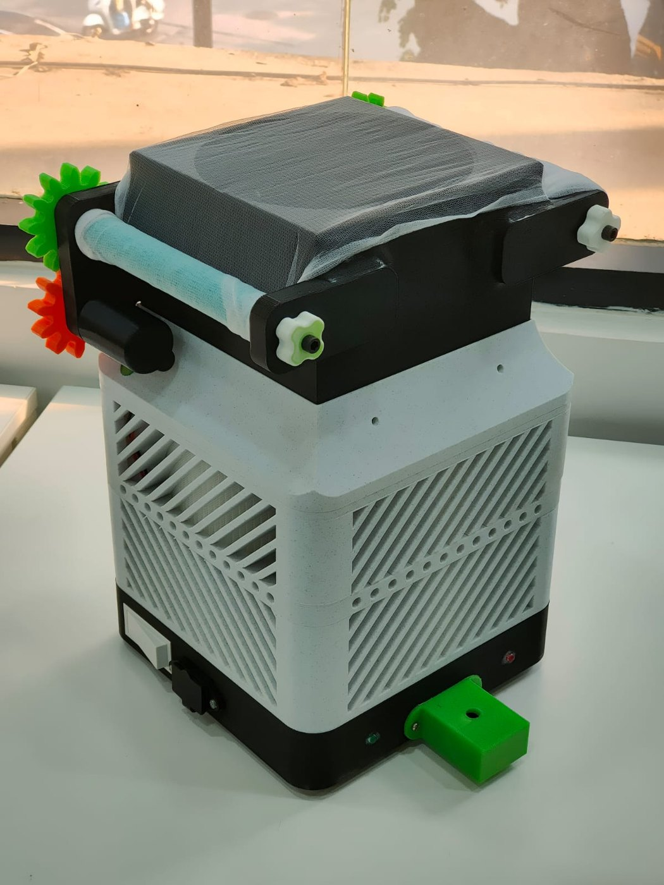

# Dust Reduction and Air Quality Monitoring System

Project reports and supporting files from **RFL Academy | Innovation Lab**.

A low-cost, room-scale dust reduction unit for home-based weaving environments, where textile lint and fine dust stay in rooms that families also live in. Room air passes through a self-refreshing roller-mesh pre-filter and a HEPA filter, driven by a 300 m³/h inline fan. An Arduino Nano reads a Sharp GP2Y10 optical dust sensor, shows the dust level in mg/m³ on a 16×2 LCD, and lights a warning LED when the level stays above a threshold set with a potentiometer. Two DC motors advance the mesh every 12 hours so the pre-filter does not clog.



## Repository contents

```
reports/    Progress Report 1 (Weeks 1 and 2), Progress Report 2 (Weeks 3 to 5), Final Report
firmware/   Air_Filter_Dust_Monitor.ino (Arduino Nano)
data/       5 CSV datasets used for the graphs
graphs/     charts used in the reports
images/     CAD renders and build photos
```

| Report | Pages | Covers |
|---|---|---|
| `AQM_Progress_Report_1_Weeks_1-2.docx` | 8 | 2D layout, component selection, bench test, first CAD concepts, first calibration readings |
| `AQM_Progress_Report_2_Weeks_3-5.docx` | 11 | Final enclosure, 3D printing, firmware, calibration, motor and power tests, control system |
| `AQM_Final_Report.docx` | 28 | Full design, calibration method, test results, challenges, limitations and source code |

## Hardware

| Component | Purpose |
|---|---|
| Arduino Nano | Main controller |
| Sharp GP2Y10 dust sensor | Optical dust sensing, analog voltage output |
| 16×2 I²C LCD (0x27) | Live dust value and threshold |
| Inline duct fan, 300 m³/h | Room air circulation through the filters |
| HEPA filter | Fine particle removal |
| 24 V 156 W SMPS + 2 buck converters | Separate 5 V logic and 12 V motor rails |
| 2 DC motors + motor driver | Roller mesh advance and take-up |
| Potentiometer, push button, LED | Threshold setting, manual rewind, warning |

### Pin map

| Arduino pin | Connected to | Notes |
|---|---|---|
| A0 | GP2Y10 Vout | Analog dust signal |
| D6 | GP2Y10 IR LED | Active LOW pulse |
| A1 | Potentiometer wiper | Threshold 0 to 25 mg/m³ |
| A4 / A5 | LCD SDA / SCL | I²C address 0x27 |
| D2 | Warning LED | Active LOW |
| D4 | Push button | External 10 kΩ pull-down |
| D9 / D12 | Left motor (driver IN1 / IN2) | Forward / reverse |
| D8 | Right motor (driver IN) | Forward only |

## Firmware

`firmware/Air_Filter_Dust_Monitor.ino` is non-blocking (`millis()` timers):

- Reads the GP2Y10 every 100 ms using the datasheet pulse timing (280 µs, 40 µs, 9680 µs).
- Converts the reading to mg/m³: `V = ADC × 5 / 1023`, `raw = 0.17 × V − 0.1`, `Dust = (raw ÷ 0.75) × 25`, clamped to 0 … 25.
- Turns the warning LED on after dust stays above the threshold for 2 s, and off after it stays below for 8 s.
- Every 12 hours runs the left motor for 1046 ms and the right motor for 2000 ms to advance the mesh. The push button reverses the left motor to rewind the strip.

Required library: `LiquidCrystal_I2C`.

## Datasets

| File | Rows | Contents |
|---|---|---|
| `01_GP2Y10_sensor_calibration_readings.csv` | 160 | ADC, voltage, calculated dust and reference value for 8 test conditions, including street dust and a construction site |
| `02_motor_current_readings.csv` | 150 | Left and right motor current every 20 ms over one mesh-indexing cycle |
| `03_supply_voltage_spike_readings.csv` | 170 | 5 V, 12 V and 24 V rails before and after the power fix |
| `04_filtration_performance_test.csv` | 180 | Room dust every minute for 3 hours next to a construction site, with fan and warning state |
| `05_warning_led_response_test.csv` | 140 | Dust, threshold and LED state every 0.5 s |

## Headline figures from the reports

| Metric | Value |
|---|---|
| Calibration accuracy (overall) | 74.4 % across 160 readings |
| Room test, average dust | 14.7 mg/m³ with the filter off, 6.6 mg/m³ with it on (about 55 % lower) |
| Motor drive energy | About 8.5 mWh per day |
| 5 V rail dip at motor start | 4.14 V before the power fix, 4.82 V after |
